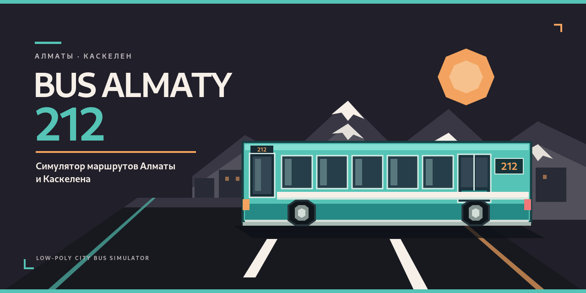

# bus_almaty_212



Браузерный автобусный симулятор по Алматы и Карасайскому району (Каскелен, Шамалган, Таугуль). Игра работает на ПК и телефоне через GitHub Pages.

**Репозиторий:** `bus_almaty_212`
**Демо:** https://bess1lie.github.io/bus_almaty_212/

## Статус (ноябрь 2026)
- [x] Three.js + Rapier физика, кабина из GLB, 3 ливреи
- [x] Город из OSM: 97 тыс. зданий, 122 тыс. дорог, 552 тайла по 2 км (~106 МБ), A* граф
- [x] Закатное небо и горы, звук двигателя/сигнала/дверей
- [x] UI Kit: HUD, меню, иконки, палитра
- [x] Маршруты 212, 230, 244 (JSON, координаты_stop期待 подтверждения)
- [x] Адаптив под Xiaomi 12 и обычный ПК
- [ ] Трафик и пешеходы
- [ ] Фоторежим и миникарта (в UI есть заглушки)

## Управление
- WASD / стрелки — газ, задний ход, руль
- Пробел — ручник
- F — двери
- C — смена камеры (кабина / снаружи)
- H — сигнал
- R — сброс
- Тач: левая половина экрана — газ/тормоз, правая — руль; кнопки HUD

## Как запустить локально
```bash
npm install
npm run dev
```
Откройте http://localhost:5173/bus_almaty_212/

## Как собрать карту
```bash
# Скачать OSM Казахстана (~226 МБ):
curl -L https://download.geofabrik.de/asia/kazakhstan/kazakhstan-latest.osm.pbf -o /tmp/kazakhstan-latest.osm.pbf

# Построить тайлы:
node --max-old-space-size=12000 tools/build-city.mjs /tmp/kazakhstan-latest.osm.pbf public/map/v1
```

## Стек
Vite 8 + TypeScript + Three.js 0.187 + Rapier 0.21 (WASM). UI — CSS из UI Kit. Ассеты — процедурные GLB. Хостинг — GitHub Pages.

## Лицензии
- Код: MIT
- Карта: © OpenStreetMap contributors (ODbL)
- Модели/иконки: CC0 / свои (поставлены ChatGPT)

Подробный план — в папке `/home/bess1lie/.opencode/plan/route-212/`.
